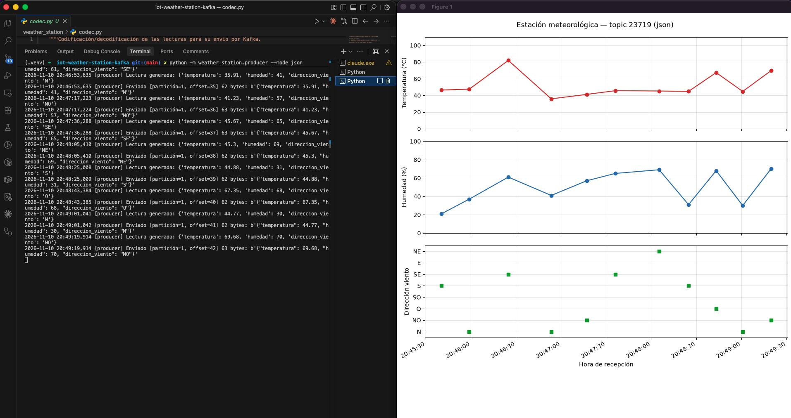
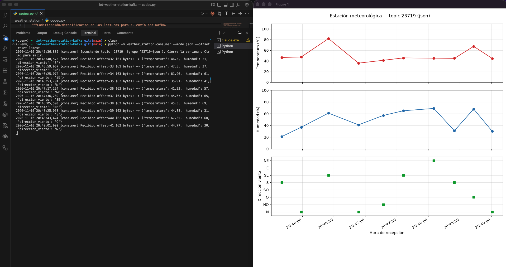
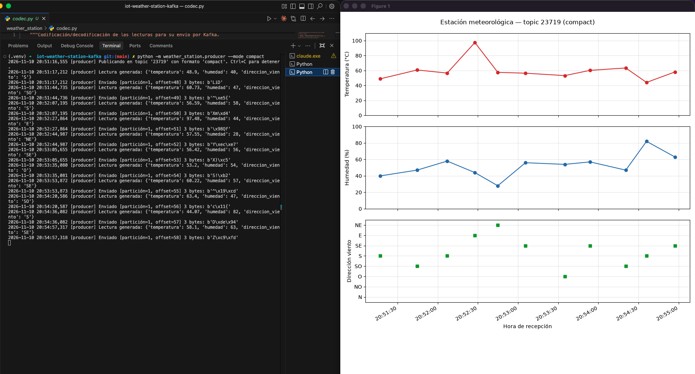
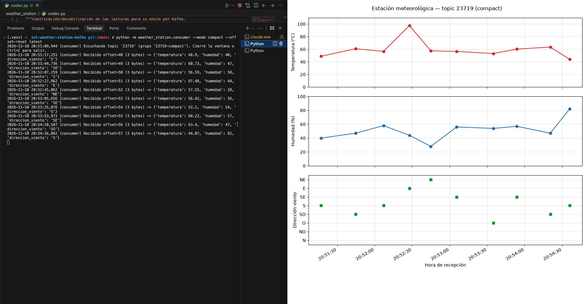

# Laboratorio IoT: Estación Meteorológica con Apache Kafka

**Curso:** Redes, Universidad del Valle de Guatemala
**Integrantes:** Jose Ruiz - 23719 | Gerardo Fernández 23763

Simulación de un nodo de sensores de una estación meteorológica que publica telemetría en un Kafka Broker ubicado en el borde (Edge, `161.35.11.141:9092`). Un consumidor se suscribe al topic y grafica los datos en tiempo real. También se implementa una versión con el payload restringido a **3 bytes**.

---

## 1. Estructura del proyecto

```
weather_station/
├── config.py     # Parámetros de conexión y autenticación SASL/PLAIN
├── sensors.py    # Simulación de sensores (temperatura, humedad, viento)
├── codec.py      # Encode/Decode: JsonCodec y CompactCodec (3 bytes)
├── producer.py   # Kafka Producer (dispositivo IoT)
├── consumer.py   # Kafka Consumer + graficación en vivo
└── plotting.py   # Gráfica en tiempo real con matplotlib
tests/            # Pruebas unitarias de sensores y codecs
```

## 2. Instalación y ejecución

```bash
python3 -m venv .venv
source .venv/bin/activate
pip install -r requirements.txt
cp .env.example .env   # luego completar KAFKA_PASSWORD con la contraseña del laboratorio
```

Las credenciales se leen del archivo `.env`, que no se versiona, para no dejarlas en el código fuente.

El topic es el número de carné de uno de los integrantes. Se pasa con `--topic` o con la variable de entorno `KAFKA_TOPIC`.

**Fases 3.1 a 3.3 (JSON):**

```bash
# Terminal 1: consumidor + gráfica
python -m weather_station.consumer --topic 23719 --mode json
# Terminal 2: productor (envía cada 15-30 s hasta Ctrl+C)
python -m weather_station.producer --topic 23719 --mode json
```

**Fase 3.4 (payload de 3 bytes):**

```bash
python -m weather_station.consumer --topic 23719 --mode compact
python -m weather_station.producer --topic 23719 --mode compact
```

Para probar más rápido se puede reducir el intervalo con `--min-interval 2 --max-interval 4`.

**Pruebas unitarias:**

```bash
python -m pytest -q
```

---

## 3. Desarrollo

### 3.1 Simulación de un sensor

`WeatherSensor` (`weather_station/sensors.py`) genera las lecturas así:

| Sensor | Rango | Tipo | Generación |
|---|---|---|---|
| Temperatura | [0, 110.00] °C | `float`, 2 decimales | Normal(μ = 55, σ = 15), recortada al rango |
| Humedad relativa | [0, 100] % | `int` | Normal(μ = 55, σ = 15), redondeada y recortada |
| Dirección del viento | {N, NO, O, SO, S, SE, E, NE} | categórico | Uniforme |

Se eligió σ = 15 porque deja aproximadamente el 99.7 % de los valores dentro de [10, 100] (μ ± 3σ). Así los datos quedan centrados en 55 y casi nunca se salen del rango.

Las lecturas se serializan en JSON:

```json
{"temperatura": 56.32, "humedad": 51, "direccion_viento": "SO"}
```

> **¿A qué capa pertenece JSON/SOAP según el Modelo OSI y por qué?**

Pertenecen a la **capa 6, de Presentación**. Esa capa define cómo se representan, codifican y estructuran los datos que intercambian las aplicaciones, sin importar cómo se transportan. JSON y SOAP (este último es XML) son justamente formatos de representación y serialización de datos. Hay que aclarar que SOAP, como protocolo de mensajería completo, también se suele asociar a la capa 7 (Aplicación), porque define operaciones y sobres de mensajes que usa la aplicación. En el modelo TCP/IP ambas capas se unen en la capa de Aplicación.

> **¿Qué beneficios tiene utilizar un formato como JSON/SOAP?**

- **Interoperabilidad:** son estándares independientes del lenguaje y de la plataforma. Un productor en Python y un consumidor en Java o JavaScript se entienden sin problema.
- **Legibilidad:** el formato es texto autodescriptivo, por lo que facilita la depuración y el registro (logging).
- **Modularidad y menos fragilidad:** los campos se identifican por nombre y no por posición. Se pueden agregar campos nuevos sin romper a los consumidores que ya existen.
- **Soporte amplio:** casi todos los lenguajes traen librerías para serializar y deserializar. SOAP además permite validar con esquemas (XSD/WSDL).
- **Estructura jerárquica:** permite representar objetos anidados y listas.

### 3.2 Envío de datos al Edge Server

`producer.py` crea un `KafkaProducer` con autenticación `SASL_PLAINTEXT` / `PLAIN` (usuario `estudiante`) contra `161.35.11.141:9092`. Publica en el topic de la pareja con la key `sensor1` y espera entre 15 y 30 segundos (intervalo uniforme) entre envíos. Corre indefinidamente hasta recibir `Ctrl+C`; en ese momento hace `flush()` y cierra la conexión.

### 3.3 Consumir y desplegar datos meteorológicos

`consumer.py` crea un `KafkaConsumer` con los mismos parámetros de autenticación, suscrito al mismo topic. Usa `auto_offset_reset="earliest"` y no guarda offsets (`enable_auto_commit=False`), así que en cada ejecución grafica primero la telemetría pasada y luego sigue escuchando los mensajes nuevos. Cada mensaje se decodifica, se agrega a las listas `all_temp`, `all_hume` y `all_wind`, y la gráfica (`plotting.py`) se actualiza en el momento con tres subgráficas: temperatura, humedad y dirección del viento contra la hora de recepción.

> **¿Qué ventajas y desventajas considera que tiene este acercamiento basado en Pub/Sub de Kafka?**

**Ventajas**
- **Desacoplamiento:** productores y consumidores no se conocen entre sí, y se pueden agregar consumidores (dashboards, alertas, almacenamiento) sin tocar el sensor.
- **Escalabilidad:** los topics se particionan y se distribuyen en varios brokers, y los consumer groups reparten la carga.
- **Persistencia y re-lectura:** los mensajes se guardan en un log durante el tiempo de retención. Un consumidor que se cae puede reanudar desde su último offset o volver a procesar datos históricos.
- **Tolerancia a fallos:** la replicación de particiones da alta disponibilidad.
- **Alto throughput y baja latencia** para flujos continuos de eventos.

**Desventajas**
- **Complejidad operativa:** hay que desplegar, configurar y monitorear el clúster (brokers, KRaft/ZooKeeper, retención, réplicas).
- **Sobrecarga para dispositivos limitados:** el cliente de Kafka y su protocolo sobre TCP son pesados para microcontroladores. En IoT real se suele poner un gateway MQTT de por medio.
- **Orden garantizado solo dentro de una partición**, no a nivel de todo el topic.
- **Sin respuesta directa:** no encaja bien con patrones de petición-respuesta.
- **Consumo de recursos** (disco y memoria) que no se justifica cuando el volumen de datos es bajo.

> **¿Para qué aplicaciones tiene sentido usar Kafka? ¿Para cuáles no?**

**Tiene sentido para:** telemetría IoT a gran escala, procesamiento de streams en tiempo real (detección de fraude, monitoreo), agregación de logs y métricas, event sourcing, arquitecturas de microservicios orientadas a eventos, pipelines de datos y CDC (Change Data Capture) entre sistemas, y seguimiento de actividad de usuarios.

**No tiene sentido para:** aplicaciones pequeñas o de bajo volumen donde una cola sencilla (RabbitMQ, Redis) o una base de datos alcanza; comunicación petición-respuesta síncrona (APIs REST/gRPC); transacciones que necesitan consultas ad hoc o funcionar como base de datos principal; dispositivos muy restringidos que se conectan directo (ahí conviene MQTT o CoAP); y sistemas de tiempo real duro con latencias garantizadas de microsegundos.

### 3.4 IoT en entornos con restricciones

`CompactCodec` (`weather_station/codec.py`) codifica cada lectura en exactamente **3 bytes (24 bits)**:

```
 bit 23                  10 9               3 2              0
    | temperatura (14 bits) | humedad (7 bits) | viento (3 bits) |
```

- **Temperatura:** se multiplica por 100 y se envía como entero, `round(t * 100)`. El máximo es 110.00 → 11 000, que es menor que 2¹⁴ = 16 384, así que cabe en 14 bits. Al decodificar se divide entre 100.
- **Humedad:** entero 0-100, que es menor que 2⁷ = 128 (7 bits).
- **Dirección del viento:** índice 0-7 en `(N, NO, O, SO, S, SE, E, NE)` (3 bits).

Los campos se empaquetan con desplazamientos de bits (`temp << 10 | hum << 3 | viento`) y se convierten a 3 bytes big-endian. La decodificación aplica máscaras para separar cada campo. Las pruebas unitarias verifican el round-trip sin pérdida para 1000 lecturas aleatorias y para los valores extremos.

Ejemplo: `{"temperatura": 56.32, "humedad": 51, "direccion_viento": "SO"}` → `5632 << 10 | 51 << 3 | 3` = `0x58019B` → `b'X\x01\x9b'` (3 bytes, frente a los 63 bytes del JSON).

> **¿Qué complejidades introduce el tener un payload restringido (pequeño)?**

- Hay que **diseñar un protocolo binario propio** y que productor y consumidor compartan exactamente la misma especificación (orden de bits, endianness, escalas). Cualquier diferencia corrompe los datos sin que nadie se dé cuenta.
- **Se pierde la autodescripción:** los bytes no son legibles, así que depurar cuesta más y se necesitan herramientas para decodificar.
- **Poca flexibilidad para evolucionar:** agregar un sensor o cambiar un rango obliga a rediseñar el formato y versionarlo, y no queda espacio para un byte de versión.
- **Pérdida de precisión o de rango:** hay que cuantizar los valores y validar que estén dentro de los límites.
- **No hay espacio para metadatos** como timestamp, ID del sensor, checksum o control de errores.
- Más lógica de validación y más casos borde en el código.

> **¿Cómo podemos hacer que el valor de temperatura quepa en 14 bits?**

Con **representación de punto fijo**: como la temperatura tiene dos decimales, se multiplica por 100 y se envía como entero sin signo. El rango [0, 110.00] pasa a ser [0, 11 000], y como 11 000 < 2¹⁴ = 16 384, cabe en 14 bits sin perder precisión. El receptor divide entre 100 para recuperar el valor original.

> **¿Qué sucedería si ahora la humedad también es tipo float con un decimal? ¿Qué decisiones tendríamos que tomar en ese caso?**

Con un decimal, la humedad tendría 1001 valores posibles (0.0 a 100.0 → ×10 → 0 a 1000), que requieren **10 bits** (2¹⁰ = 1024). En total serían 14 + 10 + 3 = **27 bits**, más de los 24 disponibles. Habría que decidir entre:

- **Reducir la precisión de la temperatura:** enviarla con un decimal (0 a 1100 → 11 bits). 11 + 10 + 3 = 24 bits cabe justo.
- **Reducir la precisión de la humedad:** mantenerla entera o cuantizarla en pasos de 0.5 (201 valores, 8 bits) y aceptar el error.
- **Reducir el rango útil:** si en la práctica la temperatura nunca baja de cierto valor, se envía con un offset y se usan menos bits.
- **Aumentar el payload a 4 bytes**, si la red lo permite, o dividir la información en varios mensajes, lo que agrega complejidad para reensamblarlos.
- **Codificación diferencial o compresión:** enviar solo el cambio respecto a la lectura anterior.

En todos los casos hay que **sacrificar precisión, rango o simplicidad** según lo que más le importe a la aplicación.

> **¿Qué parámetros o herramientas de Kafka podrían ayudarnos si las restricciones fueran aún más fuertes?**

- **`compression.type`** (gzip, snappy, lz4, zstd) en el productor, junto con **`batch.size`** y **`linger.ms`** para agrupar varios mensajes en un solo lote comprimido y reducir la sobrecarga por mensaje.
- **Omitir la key** (o usar una de 1 byte) y no usar **headers**, porque también ocupan espacio en el registro enviado.
- **Topics separados por sensor o variable:** el topic mismo identifica qué se mide, así el payload solo lleva el valor.
- **Particiones y keys** para identificar el dispositivo sin meter su ID en el payload.
- **Timestamp del registro de Kafka** (`message.timestamp`) en lugar de enviar la hora dentro del payload.
- **Schema Registry con Avro/Protobuf:** serialización binaria compacta con el esquema guardado fuera del mensaje.
- **`max.request.size`** y **`message.max.bytes`** para controlar el tamaño de las solicitudes.
- **Kafka Connect / MQTT Proxy:** permiten que los dispositivos usen un protocolo liviano (MQTT) hacia un gateway, y el gateway publica en Kafka.

---

## 4. Evidencia

### 4.1 Envío y consumo con JSON (secciones 3.2 y 3.3)

**Productor:** genera una lectura cada 15 a 30 segundos y la publica en el topic `23719`. Cada envío muestra la lectura generada, la partición, el offset asignado por el broker y el tamaño del payload (61 a 63 bytes en JSON).



**Consumidor:** recibe los mismos offsets (32 a 42) que publicó el productor, decodifica el JSON y actualiza la gráfica de temperatura, humedad y dirección del viento con cada mensaje nuevo.



### 4.2 Envío y consumo con payload de 3 bytes (sección 3.4)

**Productor:** cada lectura se codifica con `CompactCodec` y se publica como un payload de **3 bytes**, frente a los 61 a 63 bytes del formato JSON. Por ejemplo, la lectura `{"temperatura": 48.9, "humedad": 40, "direccion_viento": "S"}` se envía como `4890 << 10 | 40 << 3 | 4` = `0x4C6944` = `b'LiD'`.



**Consumidor:** recibe los mismos offsets (48 a 57), decodifica los 3 bytes de vuelta a la lectura original sin perder precisión y actualiza la gráfica igual que en la versión JSON.


